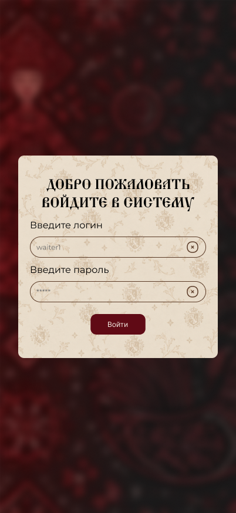

# Установка и первый вход

Перед началом работы убедитесь, что ваше устройство соответствует требованиям.

## Требования к устройству

- Мобильный телефон или планшет на Android или iOS;
- Стабильное подключение к интернету;
- Учетная запись, выданная администратором кафе.

## Как войти в систему

1. Запустите приложение на устройстве.
2. Введите логин и пароль, которые вам выдал администратор.
3. Нажмите кнопку «Войти».

Ниже показан экран авторизации:

> Если вы забыли пароль, обратитесь к администратору. Самостоятельного восстановления пароля в приложении нет.

После успешного входа система автоматически определит вашу роль и откроет нужный раздел.

Далее: [Роли пользователей](../getting-started/roles/)
