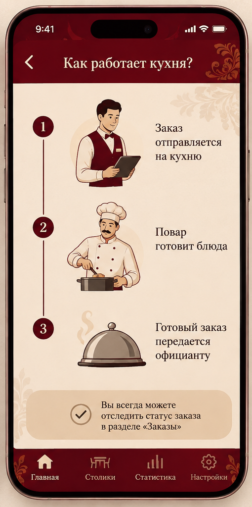

# Модуль кухни

Модуль кухни предназначен для сотрудников горячего и холодного цехов. Каждый сотрудник видит только те блюда, которые относятся к его зоне ответственности.

## Что отображается на экране

При поступлении нового заказа на экране кухни появляется карточка с информацией:
- Номер заказа и номер столика.
- Состав заказа (список блюд).
- Количество порций.
- Время поступления заказа.

Ниже приведен пример экрана с заказами:

## Действия сотрудника кухни

1. Нажмите «Принять в работу», когда начнете готовить.
2. Отметьте блюдо как «Готовится».
3. Нажмите «Готово», когда блюдо можно забирать официанту.

После того как блюдо готово, официант увидит изменение статуса на своем устройстве.