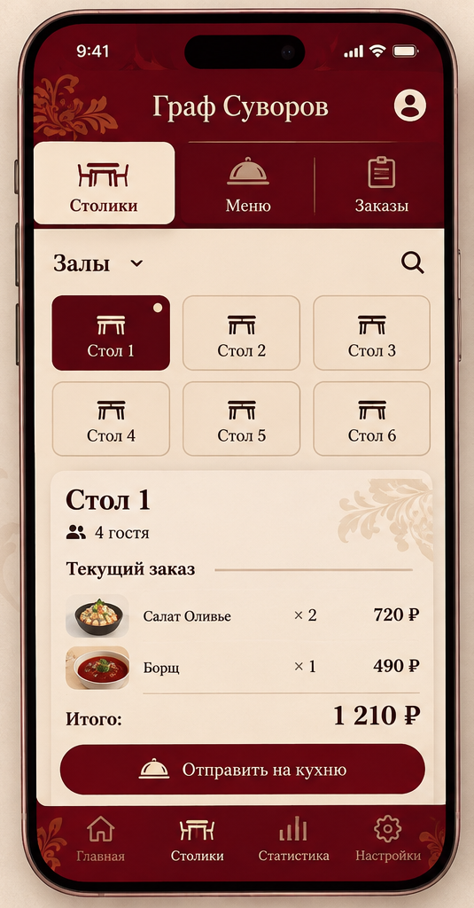

# Модуль официанта

Модуль предназначен для оформления заказов за столиками. Официант может быстро собрать заказ, проверить сумму и отправить его на кухню.

## Возможности модуля

- Просмотр меню по категориям.
- Выбор столика.
- Добавление и удаление блюд.
- Изменение количества порций.
- Просмотр итоговой суммы.
- Отправка заказа на кухню.
- Контроль статуса приготовления.

## Основной экран

Так выглядит экран выбора блюд для заказа:

Для того чтобы узнать, как правильно собрать и отправить заказ, перейдите по ссылке ниже:

[Пошаговая инструкция по созданию заказа](create-order.md)