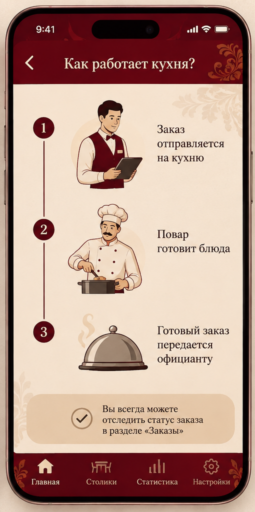

# Создание заказа

Процесс создания заказа состоит из нескольких простых шагов.

## Пошаговая инструкция

1. Откройте вкладку «Столики» и выберите нужный столик.
2. Перейдите в раздел «Меню» и добавьте блюда, которые заказал гость.
3. Укажите количество порций для каждой позиции.
4. Проверьте итоговую сумму в корзине.
5. Нажмите кнопку «Отправить на кухню».

После этого заказ уйдет на сервер, и кухня сразу его увидит.

## Переход к кухне

Чтобы узнать, как заказ обрабатывается поварами, нажмите на картинку ниже:

> **Обратите внимание:** после отправки на кухню изменить состав заказа самостоятельно нельзя. Если гость передумал, нужно подойти к сотруднику кухни.